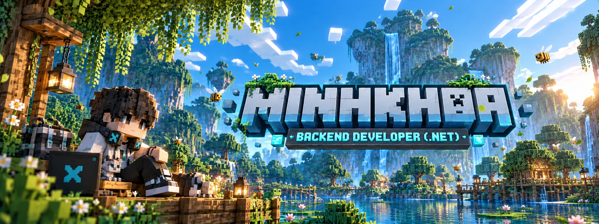

  

# Hi, I'm Minh Khoa 👋

I'm a Software Engineering student with a main focus on **Backend Development with .NET**.

I enjoy building web applications through personal projects, from designing databases and implementing business logic to testing and deployment. Along the way, I also learn frontend development and other technologies to better understand the whole application and build complete web apps on my own.

---

## 🛠 Tech Stack

  
  
  
  
  
  

  
  
  

---

## 🚀 Featured Projects

### 💬 [RealtimeChat](https://github.com/MinhKhoa05/RealtimeChat)

**Real-Time Chat & Social App**

`ASP.NET Core` • `EF Core` • `SignalR` • `WebRTC` • `React` • `TypeScript` • `MariaDB` • `Docker`

A personal project I built to explore real-time systems and develop a complete communication app. It covers core messaging features, including private and group chats, message interactions, and media sharing, alongside audio/video calls. Beyond chat, I expanded the app with social features such as posts, friend recommendations, and live trip sharing to help friends stay connected and keep track of each other during meetups.

[View Repository →](https://github.com/MinhKhoa05/RealtimeChat)

### 🎮 [GameTopUp](https://github.com/MinhKhoa05/gametopup)

**Game Top-Up Operations System**

`ASP.NET Core` • `Dapper` • `React` • `TypeScript` • `MariaDB` • `Docker`

My first personal project in web development. Although it may look like a fairly basic e-commerce application, I learned a lot from building it, from database design and full-stack development to testing and deployment. It also helped me better understand how to build reliable applications by handling transactions and addressing practical challenges such as race conditions.

[View Repository →](https://github.com/MinhKhoa05/gametopup)

---

  <i>Keep Learning • Keep Building • Keep Growing</i>

  📧 <a href="mailto:mkhoa639@gmail.com">mkhoa639@gmail.com</a>

